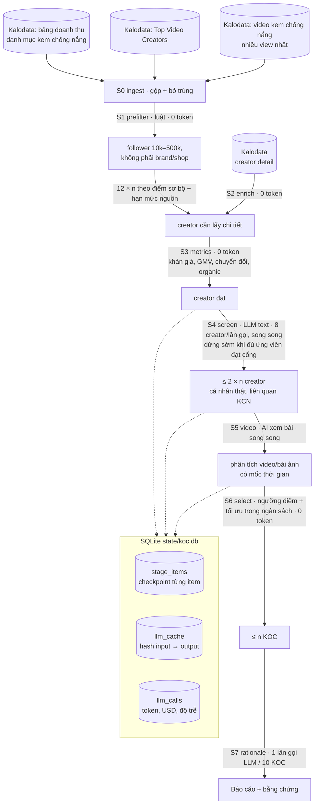

# Kiến trúc

## Ý tưởng chính: phễu "rẻ trước, đắt sau"

Chi phí AI của bài toán nằm gần hết ở bước xem video. Vì vậy hệ thống được thiết kế như một phễu:
mỗi tầng chỉ chuyển cho tầng sau những ứng viên đã qua, tầng càng đắt càng ít item.

n = số KOC cần tìm (`n_koc`). Số người ở mỗi tầng tỷ lệ với n, nên cùng code chạy cho 5 hay 500 KOC.

| Stage | Làm gì | Công cụ | Chi phí AI |
|---|---|---|---|
| S0 ingest | Đọc bảng xếp hạng creator theo danh mục | Kalodata | 0 |
| S1 prefilter | Lọc follower, tên brand/shop, chấm điểm sơ bộ | Python | 0 |
| S2 enrich | Lấy chi tiết: nhãn khán giả, 10 video doanh thu cao nhất (+ video đúng chủ đề trong bảng xếp hạng), shop, sản phẩm | Kalodata | 0 |
| S3 metrics | Điểm định lượng 6 thành phần, loại khán giả nam | Python | 0 |
| S4 screen | Phân loại account, ngách, độ liên quan, rủi ro | LLM rẻ, gom batch | rất thấp |
| S5 video | Xem 1 video/creator: đúng chủ đề, lộ mặt, thoa thử, hook, claim rủi ro | LLM đa phương thức | chiếm phần lớn |
| S6 select | Chọn n KOC tối đa điểm, tổng giá ≤ ngân sách | Python (n ≤ 6: vét cạn; n lớn: Lagrange + đổi chỗ) | 0 |
| S7 rationale | Viết lý do, trích mã bằng chứng; code kiểm trích dẫn | LLM, 1 lần gọi / 10 KOC | thấp |

## Các quyết định chính và lý do

**1. Việc gì code làm được thì không giao cho LLM.** Lọc, chấm điểm, chọn tổ hợp trong ngân sách là tính toán
tất định: code làm đúng, nhanh, tái lập được và giải thích được từng con số. LLM chỉ làm phần cần "hiểu":
đọc bio/tiêu đề, xem video, viết lời giải thích.

**2. Phễu và thứ tự tầng.** Tầng 0-token (S1–S3) cắt 150 → 15 trước khi tốn token. Bước video (đắt nhất)
chỉ chạy cho top-K (`video_per_koc` × n = 2× số KOC cần). Với 500 KOC, chi phí tăng tuyến tính theo số KOC cần chọn,
không theo số creator quét (đo bằng mô phỏng: mục Mở rộng bên dưới).

**3. Tiết kiệm token ở từng bước LLM.**
- S4 gom 8 creator/lần gọi, input đã rút gọn (tối đa 12 tiêu đề video, mỗi tiêu đề cắt 100 ký tự), prompt hệ thống cố định để dùng prompt cache.
- S5 với model không xem được video (Claude): 6 khung hình 384px (2 khung trong 3 giây đầu để chấm hook) + phụ đề TikTok nếu có, ~4.5k token/video.
  Với model xem được video (Gemini): gửi thẳng 60 giây đầu, `media_resolution=LOW`, 1 khung/giây (~100 token/giây có tiếng).
  `effort` được đổi sang `thinking_level` của Gemini; token âm thanh tính theo giá riêng (`audio_input_per_m`).
- Structured output (JSON schema) → không tốn token cho lời dẫn, không phải gọi lại vì sai định dạng.
- Cache theo hash (model + effort + prompt + input + schema): chạy lại, đổi trọng số, resume đều không gọi lại model.
  S4 còn cache theo **từng creator**: lần quét sau có người mới chen vào làm lô 8 người lệch đi thì người cũ vẫn dùng lại,
  chỉ người mới được gửi cho model. Prompt chứa brief (sản phẩm, đối tượng) nên **đổi chiến dịch thì chưa dùng lại được**:
  thiết kế tách tầng ở cuối mục 11.

**4. Định tuyến model theo bước, chọn bằng benchmark** (`config/models.toml`). Benchmark 9 model của 3 hãng trên cùng
input (`results/benchmark_models.md`, đo lại 2026-11-18 sau khi Gemini áp dụng đúng `effort`) cho thấy model đắt không
đáng tiền ở các bước này: sàng lọc dùng Gemini 3.8 Flash (khớp 91%; Claude Haiku chỉ 84%), xem video dùng Gemini 3.5
Flash-Lite (97%, xem được video có tiếng), viết lý do dùng Gemini 3.1 Flash-Lite. Chi phí dự phóng $4.81 / 500 KOC, so với
$51.05 nếu dùng toàn Opus. Mỗi bước có `fallback` (Claude Haiku) khi máy thiếu API key của model chính. Đổi model là đổi 1 dòng cấu hình, hoặc `koc run --video-model ...`. Lớp `LLM` tách
phần chung (cache, ngân sách, sổ chi phí) khỏi adapter từng nhà cung cấp (Anthropic, Gemini, DeepSeek).

**5. Bền bỉ khi gián đoạn.**
- Mỗi item xong là commit vào SQLite ngay. Process chết giữa chừng → chạy lại cùng lệnh, chỉ làm phần còn thiếu.
  `run_id` = tên chiến dịch + hash cấu hình, nên đổi cấu hình thì tự sang run mới, giữ nguyên run cũ.
- Lỗi một item (video bị xóa, video chỉ chạy quảng cáo, model trả sai) được ghi `failed`, không làm hỏng cả run; lần chạy sau thử lại tối đa 3 lần.
- Video không tải được thì tự thử video kế tiếp theo thứ tự ưu tiên.
- Chặn ngân sách: tổng chi phí run vượt `max_usd_per_run` thì dừng có kiểm soát, huỷ các video còn xếp hàng (Ctrl+C cũng vậy).
  Chạy song song có thể vượt tối đa (số luồng × chi phí 1 lần gọi) vì lần gọi đang chạy dở chưa ghi chi phí.
  Lần gọi hỏng mà hãng vẫn tính tiền (hết `max_tokens`, JSON hỏng) vẫn được ghi đúng số tiền vào sổ.
- `koc run --crash-after N` giả lập sự cố để chứng minh resume (có test tự động).

**6. Bằng chứng kiểm chứng được.** Mỗi bằng chứng có mã (`M:gmv`, `S:screen`, `V:<video_id>`). LLM viết lý do phải trích mã;
code kiểm mọi mã có thật trong input của đúng KOC đó **ngay khi model trả lời**: sai thì không lưu cache và gọi lại 1 lần
(lưu rồi thì lần gọi lại chỉ đọc đúng kết quả sai từ cache); báo cáo ghi tỷ lệ trích dẫn hợp lệ.
Điểm video cũng chỉ tính bằng chứng đúng sản phẩm: video lạc chủ đề (vd quảng cáo sữa tắm) không được điểm "thoa lên da"
hay "thấy kết cấu", vì đó không chứng minh creator review được kem chống nắng.

**7. Nhiều nguồn ứng viên, vì một bảng xếp hạng là không đủ.** Lần chạy đầu chỉ dùng bảng xếp hạng doanh thu
và phễu bị "cạn": phần lớn tài khoản doanh thu cao trong ngành kem chống nắng là shop/affiliate chốt đơn,
đăng **bài ảnh slideshow** chứ không quay video review. Hệ thống gộp 4 nguồn (bỏ trùng theo handle):
bảng doanh thu, preset *Top Video Creators*, creator đứng sau các *video* kem chống nắng nhiều view nhất
(tìm theo nội dung), và danh sách nghiên cứu web đã kiểm chứng. Nguồn ưu tiên được cộng điểm ở bước lọc sơ bộ.
Creator có mặt ở nhiều nguồn lấy số liệu của nguồn có doanh thu **so sánh được** trước (doanh thu danh mục, bán qua video),
không theo thứ tự tên file.

**8. Phễu thích ứng + ngưỡng chất lượng.** Bước sàng lọc chạy từng batch theo thứ tự điểm và dừng ngay khi đủ
`video_per_koc` × n ứng viên đạt cổng (cá nhân thật hoặc chưa rõ loại – loại này bị trừ điểm ở bước chọn; mức phù hợp
với kem chống nắng ≥ 4/10); chưa đủ thì đi sâu thêm.
Ứng viên điểm cuối dưới `min_final_score` không được đề xuất: thiếu người thì báo cáo nói thiếu, không chọn bù.

**9. Lấy được video thật để AI xem.** Khi xem không đăng nhập, TikTok **giấu link luồng video** của bài gắn giỏ hàng
hoặc chạy quảng cáo (`playAddr` trống, chỉ còn âm thanh) – mà đó lại là phần lớn bài của KOC bán hàng. Ban đầu hệ thống
hiểu nhầm các bài này là "bài ảnh"; kiểm tra trực tiếp trang TikTok cho thấy chúng là video 2–3 phút. Cách xử lý, theo thứ tự:
1. yt-dlp (có giả lập trình duyệt) tải video công khai;
2. không có luồng → lấy mp4 từ CDN của Kalodata (`video/detail/getVideoUrl` trên web; `POST /openapi/v1/tiktok/video/url` qua API).
   Link có chữ ký và hết hạn nhanh nên tải ngay (`koc fetch-videos`);
3. vẫn không có → chỉ dùng ảnh bìa + âm thanh (model nghe được mới dùng âm thanh), điểm video nhân `photo_post_factor`
   vì bằng chứng yếu hơn, và báo cáo ghi rõ "chỉ ảnh bìa".

**10. Xử lý dữ liệu thiếu một cách minh bạch.** Tài khoản Kalodata được cấp không xem được biểu đồ nhân khẩu học follower
(mọi creator hiện cùng một biểu đồ mẫu). Hệ thống dùng 3 mức, ghi rõ nguồn trong báo cáo:
số liệu đầy đủ → nhãn thô Kalodata (`Majority Female`, nhóm tuổi đông nhất) → suy từ người dẫn trong video.

**11. Bộ nhớ creator: quét tăng dần, không trả tiền hai lần cho cùng một nội dung.** Quét KOC là việc định kỳ
(hằng ngày/tuần), nên hệ thống nhớ những gì đã biết:
- **Sổ đăng ký creator** (`creator_registry` trong SQLite, `koc/registry.py`) lưu "dấu vân tay" của mỗi creator: danh sách
  video, bio, loại tài khoản, MCN, shop đang bán, nhãn khán giả, **bậc** follower (rộng 25%). Mỗi lần quét so với lần trước:
  **mới** / **thay đổi** (ghi rõ: "2 video mới", "bậc follower 57k–71k -> 71k–89k"...) / **không đổi** / **quá hạn**
  (quá `max_age_days` không có thay đổi -> nên lấy lại dữ liệu nguồn). Xem bằng `koc changes`.
- **Không đưa số liệu biến động vào LLM:** lượt xem, like, doanh thu đổi hằng ngày nhưng không làm nội dung khác đi. Input
  sàng lọc dùng bậc follower và tỷ lệ doanh thu làm tròn; input video chỉ có mô tả + thời lượng + chính video. Nhờ vậy
  kết quả phân tích được khoá theo **nội dung** (hash input) và dùng lại mãi: video đã xem thì không bao giờ trả tiền xem lại.
- **Đếm tiền tiết kiệm:** cache lưu kèm chi phí gốc; mỗi lần dùng lại ghi `saved_usd`. Thực đo: quét lại cùng dữ liệu
  -> 43/43 creator không đổi, 12/12 lần gọi dùng lại, **$0 và 23 giây** thay vì $0.0235 và 92 giây.
- **Quét định kỳ:** đặt lịch `koc run --run-id quet-<ngày>` (Task Scheduler/cron). Mỗi lần chỉ trả tiền cho creator mới,
  video mới, hồ sơ đổi. Với Kalodata API: gọi `creator/rank` (rẻ) mỗi ngày -> chỉ gọi `creator/detail` cho creator mới,
  quá hạn hoặc đổi bậc follower/doanh thu -> chỉ gọi LLM cho phần nội dung mới.

**Thiết kế tiếp theo – dùng lại cho chiến dịch khác.** Hiện prompt chứa brief (sản phẩm, đối tượng) nên đổi chiến dịch thì
cache không dùng lại được. Tách 2 tầng:
| Tầng | Nội dung | Khoá cache | Chạy khi |
|---|---|---|---|
| Hồ sơ nội dung (đắt, dùng chung) | Mỗi video: sản phẩm/thương hiệu xuất hiện, ngành hàng, lộ mặt, thử trên da, chất lượng, hook, claim rủi ro, tóm tắt lời nói. Mỗi creator: loại tài khoản, ngách | `video_id` + phiên bản prompt + model | Video mới |
| Chấm theo chiến dịch (rẻ) | Độ phù hợp với sản phẩm/đối tượng của brief, từ hồ sơ trên | hồ sơ + brief | Mỗi chiến dịch |

Tầng 2 chỉ đọc text ngắn (vài trăm token/creator, gom batch), nên một chiến dịch mới trên kho 500 creator đã phân tích tốn
cỡ vài cent và vài phút thay vì phân tích lại toàn bộ video.

## Thu thập dữ liệu: hiện tại và bản production

Prototype lấy dữ liệu Kalodata qua giao diện web (một agent đọc trang bằng trình duyệt, lưu snapshot JSON),
vì tài khoản được cấp chưa có API key. Phần lọc theo brief **không phụ thuộc** cách thu thập: mọi bước sau
`koc.sources.kalodata` chỉ đọc JSON theo schema cố định.

Kalodata có Open API chính thức (`https://www.kalodata.com/open-center/docs`, POST + JSON, header `secret-key`,
0,1 điểm/lần gọi). Bản production thay snapshot bằng các lời gọi sau, tham số lấy thẳng từ `campaign.toml`:

| Nguồn ứng viên | Endpoint | Tham số từ brief |
|---|---|---|
| Bảng doanh thu | `POST /openapi/v1/tiktok/creator/rank` | `region=VN`, `currency=VND`, `date_range=last30Day`, `category_id_list`, `creator_type=INDEPENDENT`, `followers_range=10000-500000`, `page_size=100` (≤10 req/10s) |
| Top Video Creators | như trên, `sort_field={"field":"video_revenue"}` | |
| Video organic nhiều view | `POST /openapi/v1/tiktok/video/rank` | danh mục + sắp theo `views`, lọc `ad=0` |
| Chi tiết creator | `POST /openapi/v1/tiktok/creator/detail` | `creator_id` |
| Link video (cả bài ảnh) | `POST /openapi/v1/tiktok/video/url` | `video_id` – thay yt-dlp khi TikTok chặn |

Với 500 KOC theo cấu hình hiện tại (lấy chi tiết 12 × n người): 6.000 lần gọi chi tiết ≈ 600 điểm, ~1,7 giờ theo giới hạn
tốc độ – nút thắt thời gian lớn nhất. Lấy chi tiết theo đợt (như bước sàng lọc) còn ~1.500 lần ≈ 150 điểm, ~25 phút (chưa làm).
Danh sách KOC do AI tìm trên web (Gemini) chỉ là nguồn phụ tuỳ chọn và luôn được đối chiếu với Kalodata:
24/31 handle tìm thấy, 7 không tồn tại hoặc không có dữ liệu.

## Mở rộng lên 50–500 KOC

**Đã làm và đo.** `koc scale-test` chạy nguyên pipeline (dữ liệu Kalodata giả lập, model giả, 0 đồng) ở 5 / 50 / 500 KOC.
Kết quả: [`results/scale_test.md`](results/scale_test.md), tab "Mở rộng 50–500 KOC" trên web.

| Quyết định | Lý do | Số đo ở 500 KOC |
|---|---|---|
| Tầng phễu = hệ số × n (`enrich_per_koc`, `screen_per_koc`, `video_per_koc`) | Chi phí tuyến tính theo số KOC, không theo số creator đầu vào; 5 KOC giữ nguyên 60/40/10 | 12.500 creator → 1.204 lần gọi model, $3.56 dự phóng |
| Sàng lọc song song theo đợt, mỗi đợt số batch vừa đủ phần còn thiếu | Giữ tính "dừng sớm" của phễu thích ứng mà không chạy tuần tự | 154 lần gọi sàng lọc; cả 3 bước gọi model: 25 phút (4 luồng) / 6 phút (16 luồng) |
| Viết lý do chia lô 10 KOC/lần gọi, song song | 1 lần gọi cho 500 KOC vượt giới hạn token ra | 50 lần gọi |
| Bài chọn: n ≤ 6 vét cạn; n lớn nhân tử Lagrange + đổi chỗ | Vét cạn bùng nổ tổ hợp; Lagrange chỉ cần sắp xếp, đổi chỗ tận dụng ngân sách còn dư | 2 ms; trùng đáp án vét cạn 99,4% trên 1.000 bài nhỏ ngẫu nhiên |
| SQLite chế độ WAL, `synchronous=NORMAL` | Commit từng item để resume; chế độ mặc định chờ ghi đĩa 103 ms/commit | Code cả pipeline 18,5 giây ở 500 KOC (trước khi sửa: 50 KOC đã mất 193 giây) |
| Xếp hạng phần trăm bằng tìm nhị phân | Bản cũ O(N²) | – |

**Khi lên production:**

| Hạng mục | Prototype | Khi scale |
|---|---|---|
| Nguồn dữ liệu | Snapshot JSON thu từ giao diện Kalodata | Kalodata Open API, phân trang có checkpoint từng trang; lấy chi tiết theo đợt |
| Song song | ThreadPool `concurrency` luồng (mặc định 4) | Hàng đợi (Redis/SQS) + worker, rate limit theo nhà cung cấp |
| Trạng thái | SQLite 1 file (32 MB ở 500 KOC) | Postgres (cùng schema bảng) khi nhiều worker ghi cùng lúc |
| Gọi LLM số lượng lớn | Gọi trực tiếp | Batch API (rẻ 50%) cho S4/S5 vì không cần trả lời ngay |
| Ngân sách mỗi run | `max_usd_per_run` = $1 | Đặt theo dự phóng (~$0.005/KOC → 500 KOC ~ $5) |
| Đa dạng | Tối đa 1 KOC mỗi nhóm chung liên hệ | Thêm ràng buộc tối đa X KOC cùng MCN / cùng ngách |
